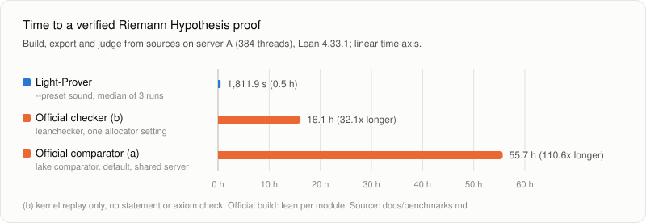
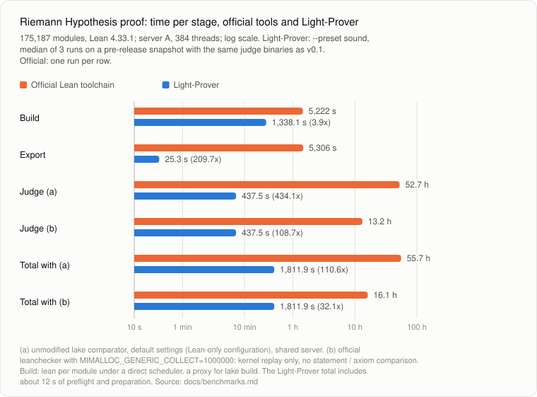

# Light-Prover

Light-Prover checks that a Lean 4 project proves the statements of a pinned challenge, with the same answer as the
official `lake comparator`, in less time and memory. The build and the export run outside the trusted part; a small
pinned judge decides. It is meant for large formal proofs, AI provers and RL pipelines that need a sound verdict per
attempt, and CI on proof repositories. Linux x86-64. Version 0.1.0, not externally audited.

<p align="center">
  <picture>
    <source media="(prefers-color-scheme: dark)" srcset="webpage/assets/framework-dark.svg">
    
  </picture>
</p>

## The guarantee

An ACCEPTED verdict with trust `sound` means: the judged export proves every target statement of the challenge, as
written in the official challenge export, using only the permitted axioms. The statements and axioms are compared by
the official comparator code (`compareAt`, `checkAxioms`); every declaration in the targets' closure is replayed by the
unmodified official Lean kernel sources and, independently, by a second kernel that can only veto. The challenge export,
its comparator configuration and every judge binary are pinned by sha256. The build, the exporter, caches and services
are untrusted: a bug in them can cost a verdict, not turn an invalid proof into ACCEPTED. DECLINED, NO-VERDICT and
ERROR are no verdict and count as failures. Details and the exact trusted base: [soundness model](docs/concepts/soundness.md).

## Measured

The Lean 4.33.1 proof of the Riemann Hypothesis (175,187 modules, 61.6 GB export), on server A (x86-64, 384
hardware threads): about 32x end to end and 109x for the judge against the official checker with one allocator setting; 110.6x /
434.1x against the default official comparator run.

<p align="center">
  <picture>
    <source media="(prefers-color-scheme: dark)" srcset="webpage/assets/rh-timelapse-dark.svg">
    
  </picture>
</p>

| stage | official tools, one run | Light-Prover `--preset sound`, median of 3 runs on a pre-release snapshot with the same judge binaries as v0.1 | ratio |
|---|---:|---:|---:|
| build | 5,222 s (official Lean 4.33.1 `lean` per module under a direct scheduler, a proxy for `lake build`) | 1,338.1 s | 3.9x |
| export | 5,306 s (official exporter) | 25.3 s | 209.7x |
| judge (a) | 189,899 s (unmodified `lake comparator`, default settings, Lean-only configuration) | 437.5 s | 434.1x |
| judge (b) | 47,563 s (official `leanchecker` with `MIMALLOC_GENERIC_COLLECT=1000000`; kernel replay only) | 437.5 s | 108.7x |
| total from sources with (a) | 200,427 s (55.7 h) | 1,811.9 s | 110.6x |
| total from sources with (b) | 58,091 s (16.1 h) | 1,811.9 s | 32.1x |

The default comparator run (a) shared the server with other jobs, and 72-91 % of its CPU went to the allocator's
periodic heap collection; (b) adds only an allocator setting that removes most of this collection, but it replays the
kernel only and does not do the comparator's statement and axiom comparison, which takes about 85 s inside Light-Prover's
judge. The official comparator starts its kernel with a cleared environment, so an allocator setting cannot be passed to
it by ordinary means; that is why (b) runs `leanchecker` directly. The `lake comparator` itself with that setting has not
been measured yet; a run is planned. The build settings of
Light-Prover were tuned on earlier runs of this proof. The Light-Prover total includes about 12 s of preflight and preparation; the sha256 of the export runs
beside the judge. On the released package (v0.1.0 code), one run: 1,798.7 s total (build 1,346.5 s, export 25.1 s,
judge 414.8 s), ACCEPTED; that run peaked at about 472 GiB of memory (cgroup memory.peak, including the 61.6 GB export
on tmpfs).

<p align="center">
  <picture>
    <source media="(prefers-color-scheme: dark)" srcset="webpage/assets/rh-stages-dark.svg">
    
  </picture>
</p>

Judging the existing export alone took 423.2 s at 384 threads (median of 2). Under a 128 GB memory limit the low-memory
judge (32 threads) took 1,297 s in a run concurrent with its four mutant checks (all REJECTED), and 1,589.0 s in
another run with the same binaries, concurrent with five other runs. Under 64 GB the ultra-low-memory judge (24 threads)
took 4,265.6 s (memory.peak 62.2 GiB); its four mutant checks were REJECTED within 64 GB, M1 and M2 on machine B.
On the other measured projects (77 mathematics claims, 9 code-verification projects, 4 new openai/math challenges;
end to end) the ratio ranges from 0.6x (LNSym, Light-Prover slower) to 6.2x (flt-regular, Light-Prover on the released package,
official time from an earlier run on the same machine type). 413 of 413 openai/math
comparator challenges got the official verdict (judge only); 2 large new challenges that the official comparator
accepted got no verdict. Conditions, the other machines and every disagreement: [docs/benchmarks.md](docs/benchmarks.md).

## Quick start

```bash
git clone <repository-url> Light-Prover && cd Light-Prover
# build the pinned components first: docs/getting-started.md
python3 -I fastverify/tools/configure.py --elan-home "${ELAN_HOME:-$HOME/.elan}" --light-lean "$PWD"
fastverify/bin/fv doctor --project ./my-repo

# verify a project from sources
fastverify/bin/fv verify ./my-repo -c ./challenge --challenge-sha256 "$PIN" --comparator-sha256 "$CPIN"

# judge an existing export (--low-mem on machines with less memory)
fastverify/bin/fv check ./solution.export -c ./challenge --challenge-sha256 "$PIN" --comparator-sha256 "$CPIN"

# a proof with sorry: CONDITIONAL, with the list of open lemmas
fastverify/bin/fv verify ./my-repo -c ./challenge --challenge-sha256 "$PIN" --comparator-sha256 "$CPIN" --modulo-frontier auto
```

`$PIN` is the sha256 of the official `challenge.export`, `$CPIN` that of its `comparator.json`; both are required,
because the configuration decides which statements and axioms are checked. Requirements: Linux x86-64 with glibc,
bubblewrap, Python 3.10+, the official Lean toolchains via elan, and C/C++ and Rust toolchains to build the fast
components. The repository ships sources and build recipes, no binaries.

## What is in v0.1

| status | components |
|---|---|
| **Stable** | the sound judge with the presets `sound-auto` and `sound`; the low-memory, ultra-low-memory and Lean 4.37.0-rc1 judges; `fv verify`, `fv check`; conditional verdicts (`--modulo-frontier`, frontier run / verify); the MCP verify tools; `fvserve`, `batchverify`; the HTTP API with an explicit `theorem`; the Lean releases admitted by the cross-version gate, v4.26.0-rc1 to v4.37.0-rc1 (`tools/configure.py` registers 4.33.1 and 4.36.0, `tools/addrelease.py` the others; 14 have shipped toolchain manifests) |
| **Opt-in** | the extra veto kernels `con-leche` and `nanoda`; `--require-sorried-holes` |
| **Experimental** (may change; opt-in flag where named) | the notary preset, `fv watch`, `fv triage`, `fv ci` and the GitHub action (each `--experimental`); sub-challenges (`tools/subcontract/`, `--experimental`); the incremental machinery (`--experimental-incremental`; the incremental entry points run cold without it); theorem inference of the HTTP API (`--experimental-theorem-inference`) |
| **Not in v0.1** | the warm delta judge: fvwork, fvserve and incr-reverify refuse it; the standalone `check/warm/fvcheckd.py` is research code, is not sound in its current form, and is not used by any entry point |
| **Retired** | the legacy judge check A and the presets `fast-exact` and `default` (refused with a message naming the replacement) |

The fast build runs only for project shapes in which it builds exactly the modules Lake builds. In short: a
`lakefile.toml` root library contains the configured module, the `lakefile.toml` is pure ASCII including its comments,
there is no `lakefile.lean` anywhere, module names are plain ASCII, and the release is Lean 4.33.1 (all fast builds) or 4.36.0 /
4.37.0-rc1 (only the transformed build B3 of `--preset sound` and `sound-auto`; the exact fast build B1 is validated for
4.33.1 only). Every other project gets the official `lake build`. The exact rule:
[which build runs](docs/reference/options.md#which-build-runs).

Known limitations: [docs/limitations.md](docs/limitations.md). Changes: [CHANGELOG.md](CHANGELOG.md).

## Documentation

- [Getting started](docs/getting-started.md): prerequisites, building the pinned components, a first verification
- [User guide](docs/user-guide.md): projects, exports, conditional verdicts, daemons, services, CI
- [Reference](docs/README.md#reference): command line, presets and options, `result.json`
- [Soundness model](docs/concepts/soundness.md) and [architecture](docs/concepts/architecture.md)
- [Benchmarks](docs/benchmarks.md) and [limitations](docs/limitations.md)
- [`fastverify/`](fastverify/): the package; [`sources/`](sources/): sources of the fast components;
  [`webpage/`](webpage/): the project page, charts drawn from [one data file](webpage/charts/data.json)

The Riemann Hypothesis proof is not redistributed (its author published it without a license).

## License

Apache License 2.0, see [LICENSE](LICENSE); third-party components keep their own licenses (see [NOTICE](NOTICE)).
